# Pramarta Ehsan Jaya

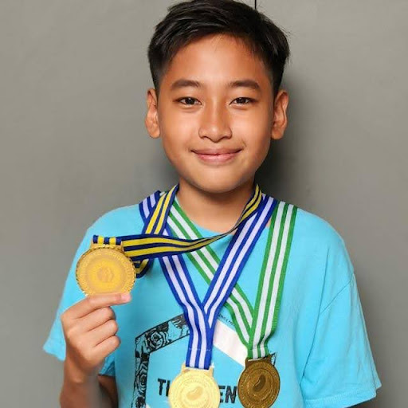

14 tahun | Lumajang, Jawa Timur  
pramartaej@gmail.com  
0851-8685-3020  
4 Kurasi [Puspresnas](https://simt.kemendikdasmen.go.id/resume?id=7aRFGGMBbE_kc-US-WZlSQ&name=pramarta-ehsan-jaya) (satu dalam proses verifikasi)  
[github.com/ehsanjaya](https://github.com/ehsanjaya)  
[ig](https://www.instagram.com/pramartaehsan) | [yt](https://www.youtube.com/@EhsanJaya)

---

## Riwayat Pendidikan

- 2026 - Scholarship awardee SMA ABBS, Klaten
- 2026 - Scholarship awardee SMA Global Darussalam Academy, Jogja
- 2026 - Scholarship awardee SMA RUSHD, Sragen
- 2024 - MTS Negeri 1 Lumajang
- 2021 - Homeschooling
- 2019 - SDN 3 Tompokersan Lumajang

---

## Skills

C++ | C# | Kotlin | Python | Unity | Android Jetpack Compose | YOLO | IoT | ESP32

---

## Prestasi

1. **2026 - Juara 2 Imajination 2026**  
   _Juara 2 kategori Battle Coding Makers Assemblr 2026 di Kemendikdasmen, Jakarta, 5 November 2026_

   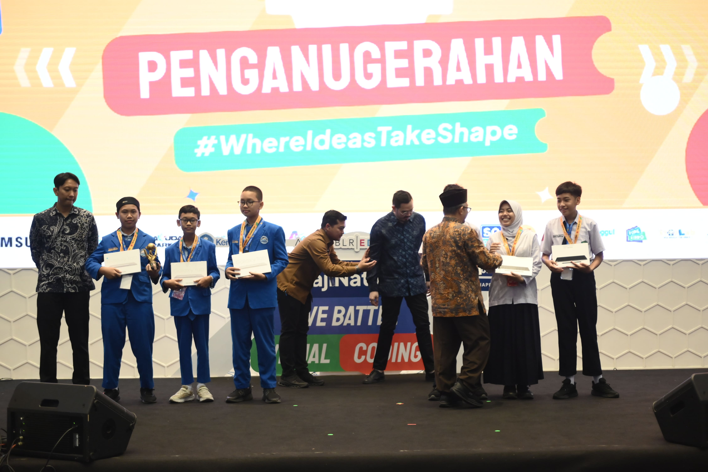  
   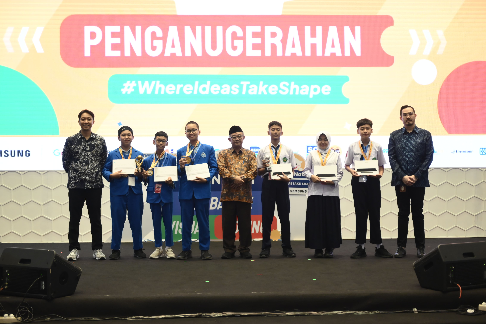

   Referensi:  
   [Karya](https://www.youtube.com/watch?v=VvL41FjYbQs)  
   [Assemblr Imajination 2026](https://edu.assemblrworld.com/id/imajination-2026)  
   [Antara](https://www.antaranews.com/berita/5837599/kemendikdasmen-assemblr-edu-hadirkan-ruang-kembangkan-talenta-digital)  
   [Gubernur Jatim](https://www.instagram.com/p/Dfd5q80BQbU)  
   [Seminal](https://www.youtube.com/watch?v=UE8stVH02F0)  
   [Final](https://www.youtube.com/watch?v=iMXL4qFYNLU)  
   [Penganugerahan](https://www.youtube.com/watch?v=ZFRXiFvcjHM)

2. **2026 - Juara 1 Coding & Game Competition**  
   _Juara 1 kategori Coding & Game ABBS Talent Fest 2026 di SMA ABBS, Klaten, 26 Agustus 2026_

   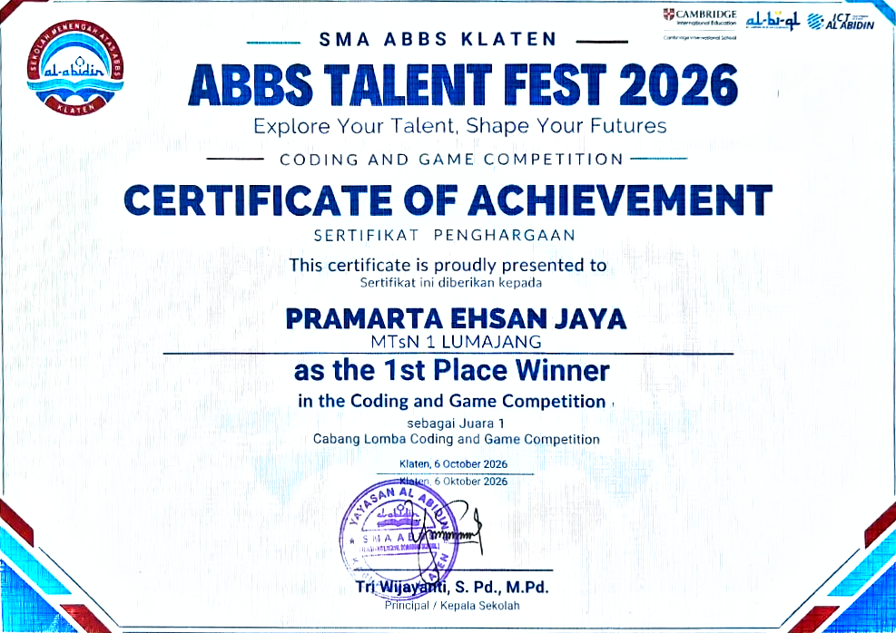

   Referensi:  
   [Karya](https://www.instagram.com/p/Dd29Sb1CT36)  
   [SMA ABBS](https://www.instagram.com/p/DeJlosBIxOU/)

3. **2026 - Juara 1 Coding GDA Future Defenders**  
   _Juara 1 kategori Coding Scratch Junior High School di Global Darussalam Academy, Yogyakarta, 7 Februari 2025_

   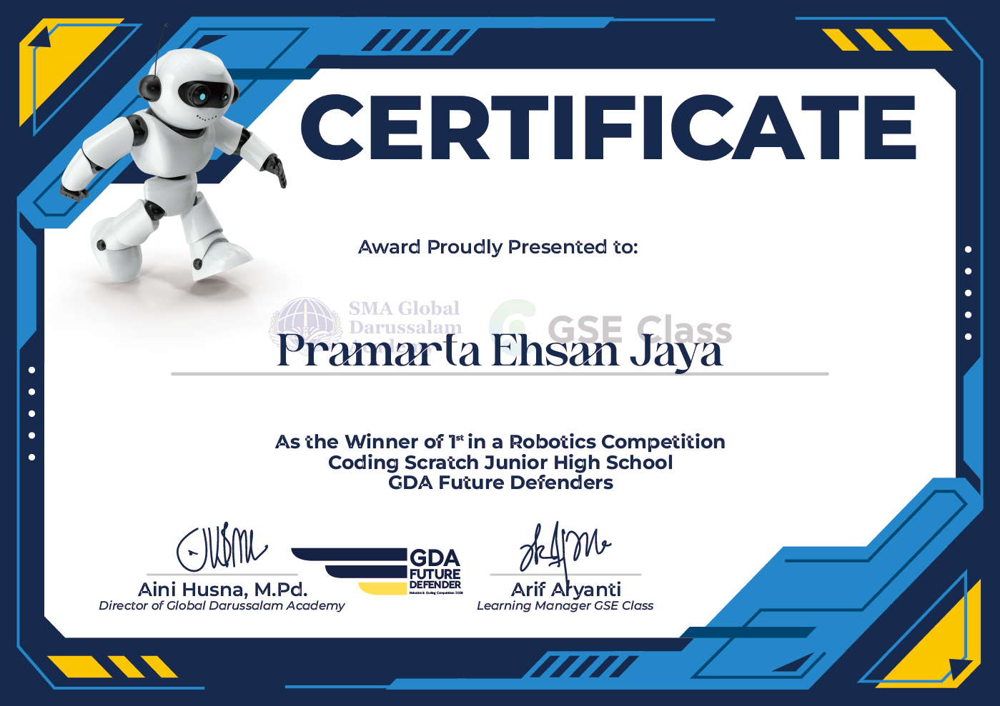  
   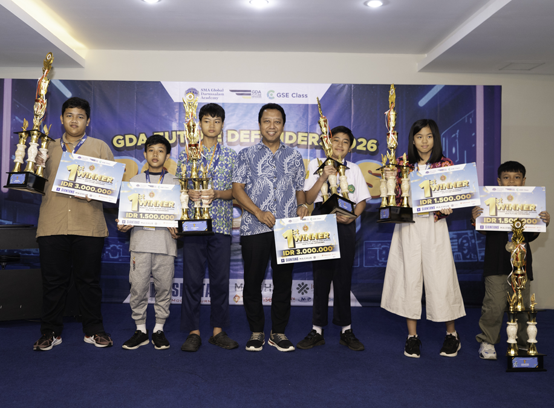

   Referensi:  
   [Tribun Jogja](https://jogja.tribunnews.com/diy/1207868/sma-global-darussalam-academy-gelar-kompetisi-robotik-nasional)

4. **2025 - Hak Cipta (IP) HAKI EC002025185290**  
   _HAKI Nomor 001025550, Jenis Ciptaan: Program Komputer, Judul Ciptaan: Planetarium 360: Aplikasi Planetarium Multi Platform pada Desktop, Mobile dan Virtual Reality (VR) Berbahasa Indonesia._

   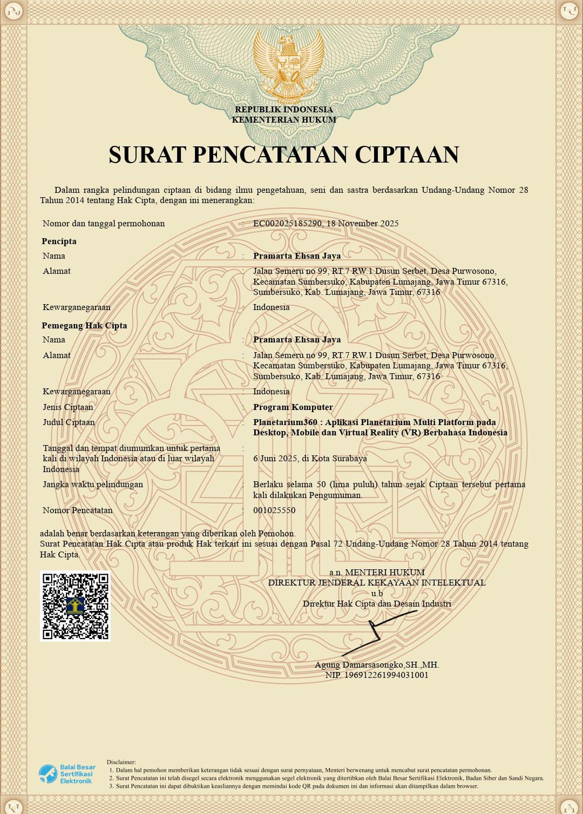

   Referensi:  
   [Pangkalan Data Kekayaan Intelektual](https://pdki-indonesia.dgip.go.id/link/45433030323032353138353239307c636f70797269676874)

5. **2025 - Juara 1 Bina Talenta Indonesia - Puspresnas**  
   _Terpilih sebagai The Best Coder dan Juara 1 The Best Project Koding dan Kecerdasan Artifisial (KKA) di Universitas Padjadjaran (Unpad), Jatinangor, 7-13 Desember 2025 yang diselenggarakan oleh Puspresnas. Judul aplikasi: Bisa Mandiri, Asisten AI Mobile Untuk Membantu Tuna Grahita Mengenal Obyek_

   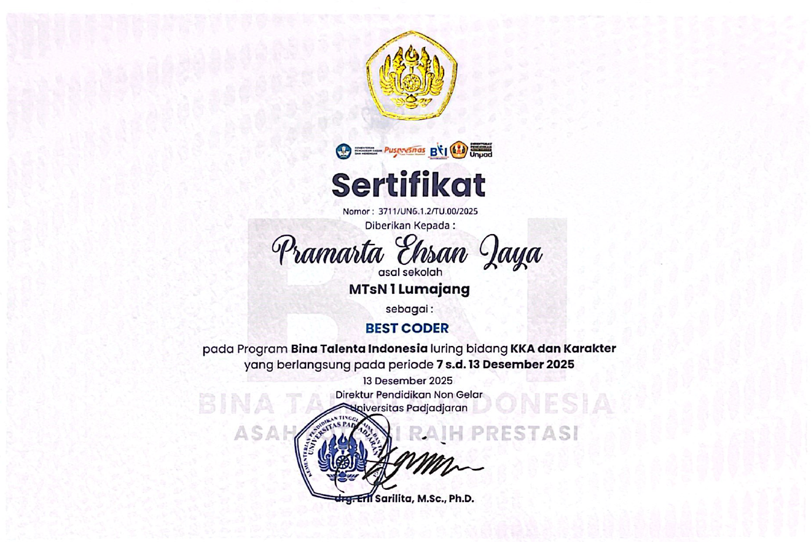  
   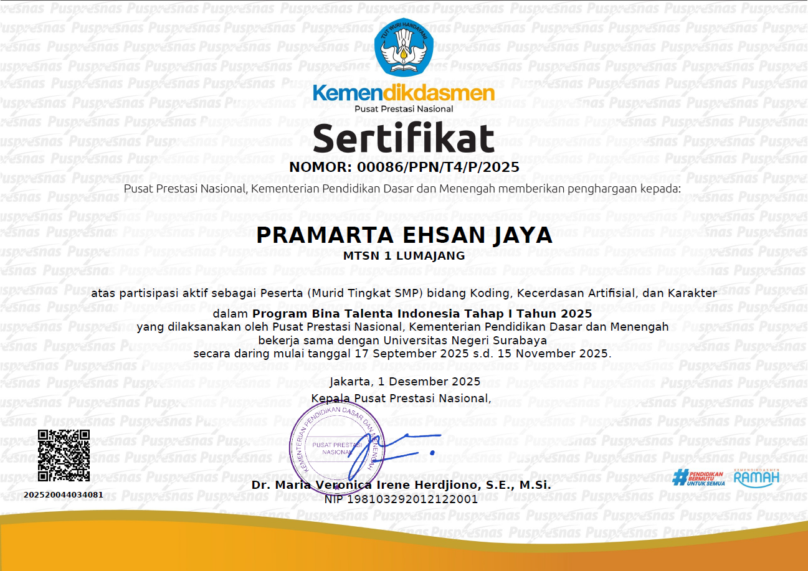  
     
   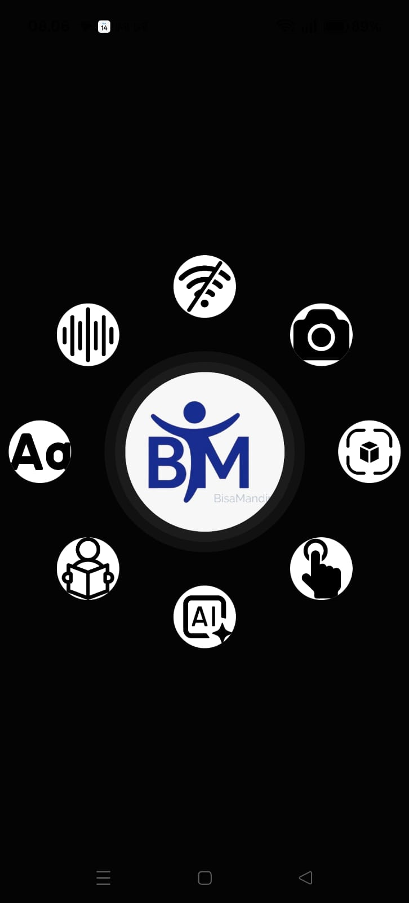

   Referensi:  
   [Bina Talenta Indonesia](https://binatalenta.kemendikdasmen.go.id)  
   [Bisa Mandiri](https://github.com/ehsanjaya/bisamandiri)

6. **2025 - Gold Bidang Inovasi Berbasis Kemanusiaan dan Sosial InYSIA 2025 (Terkurasi Puspresnas)**  
   _Indonesia Young Scientists and Inventors Award 2025 (Abak Academy), Universitas Gajah Mada (UGM), Yogyakarta._  
   [emurojaahquran.github.io](https://emurojaahquran.github.io/)

   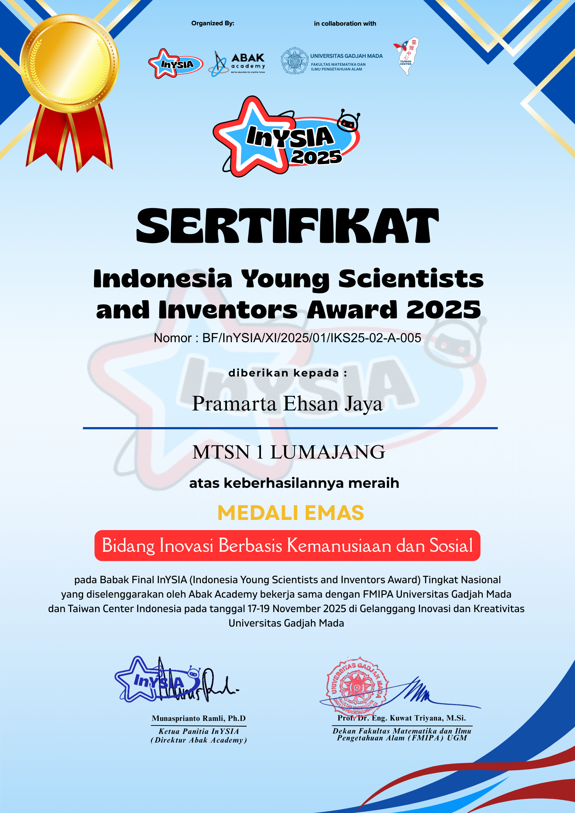

   Referensi:  
   [InYSIA](https://inysia.com/finalis-inysia-jenjang-smp-mts-sederajat)  
   [Pemenang InYSIA](https://www.youtube.com/live/JXrVFrt_8IY?si=M_hy06JoxzwXHJhv)

7. **2025 - Juara 2 Bidang Komputer Lomba Peneliti Belia PUTech 2025 (Terkurasi Puspresnas)**  
   _Lomba Peneliti Belia & International Scientific Paper Competition 2025, Politeknik PU (PUtech) Semarang._

   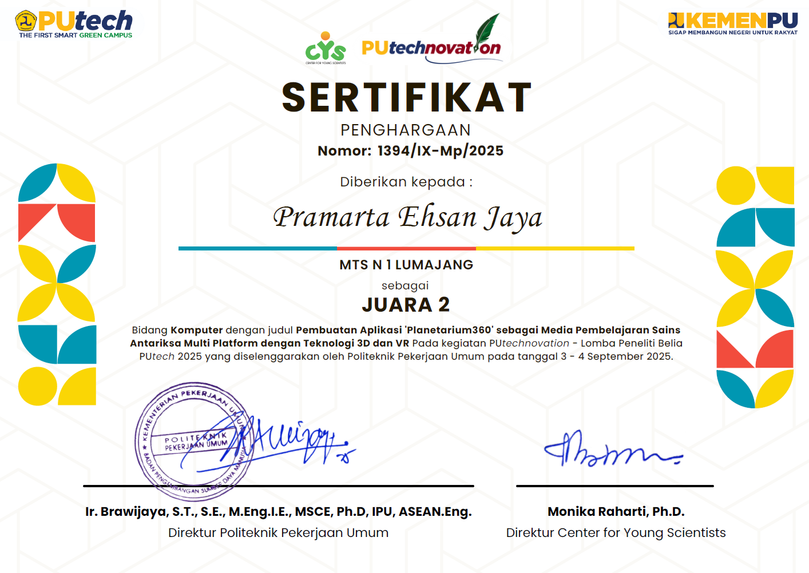  
   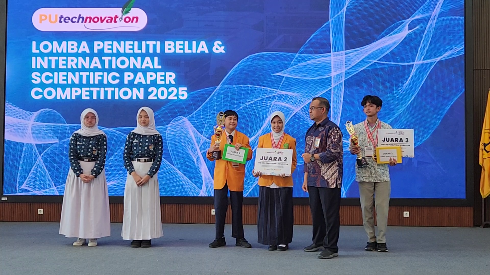

   Referensi:  
   [Berita Jatim](https://beritajatim.com/pelajar-madrasah-lumajang-raih-prestasi-tingkat-nasional)  
   [Politeknik PU](https://politeknikpu.ac.id/2025/09/05/putechnovation-2025-resmi-ditutup-inilah-para-pemenang-lpb-dan-lkti)

8. **2025 - Best Top 4 Indonesia Aerospace Hakathon 2025 (Terkurasi Puspresnas)**  
   _Satu-satunya peserta sekolah menengah pertama yang terpilih best top 4 diantara mahasiswa UI, PENS, Binus dan UPN di 21st Asia Pacific Satellite International Conference Hakathon 2025 diselenggarakan Asosiasi Satelit Seluruh Indonesia (ASSI), Fairmont Hotel Jakarta._

   [planetarium360.github.io](https://planetarium360.github.io/)

   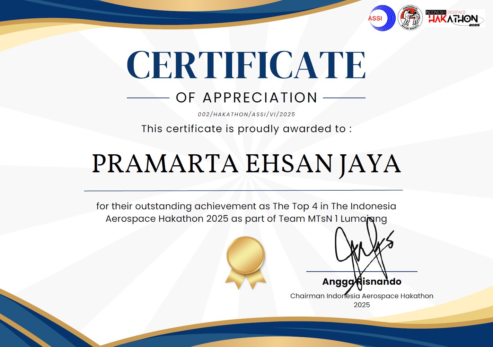  
   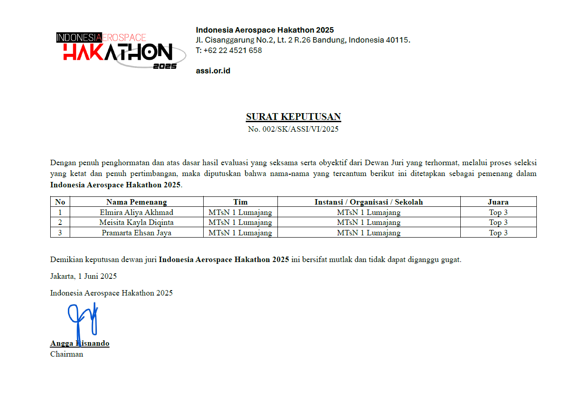  
   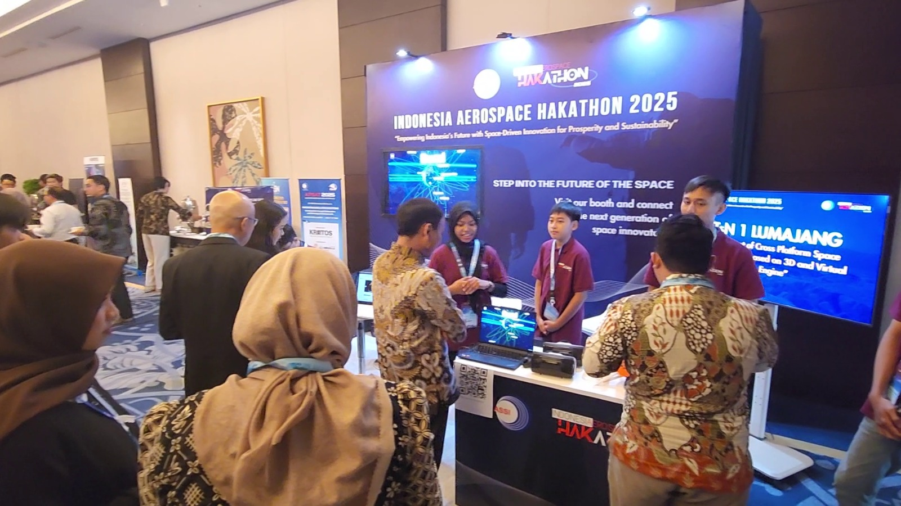  
   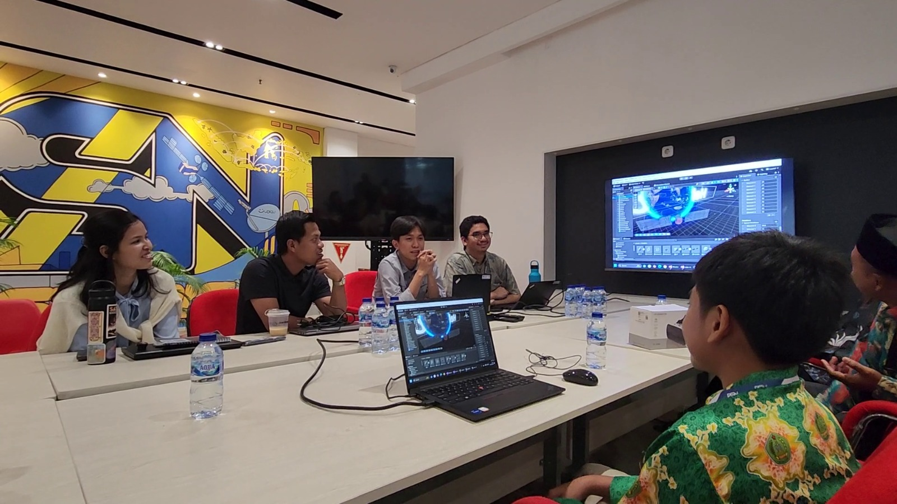  
   

   Referensi:  
   [ASSI](https://www.instagram.com/p/DL9jJ-2Tib4/)  
   [Kemenag Jatim](https://jatim.kemenag.go.id/berita/543232/kembangkan-aplikasi-planetarium360-tim-mtsn-1-lumajang-berhasil-raih-top-4-indonesia-aerospace-hakathon-2025)  
   [Dinas Kominfo Jatim](https://kominfo.jatimprov.go.id/berita/aplikasi-planetarium360-antarkan-tim-mtsn-1-lumajang-masuk-top-4-indonesia-aerospace-hackathon-2025)  
   [Mimbar Kemenag](https://www.mpajatim.com/auth/news_detail/mts-negeri-1-lumajang-generasi-emasnya-raih-juara-coding-internasional)  
   [Binus](https://socs.binus.ac.id/2025/06/28/mahasiswi-data-science-binus-university-raih-penghargaan-aplikasi-terbaik-di-indonesia-aerospace-hackathon-2025)

9. **2025 - Semifinalis OPSI 2025 - Puspresnas**  
   _Olimpiade Penelitian Siswa Indonesia 2025._

   [kodingbotapp.github.io](https://kodingbotapp.github.io/)

   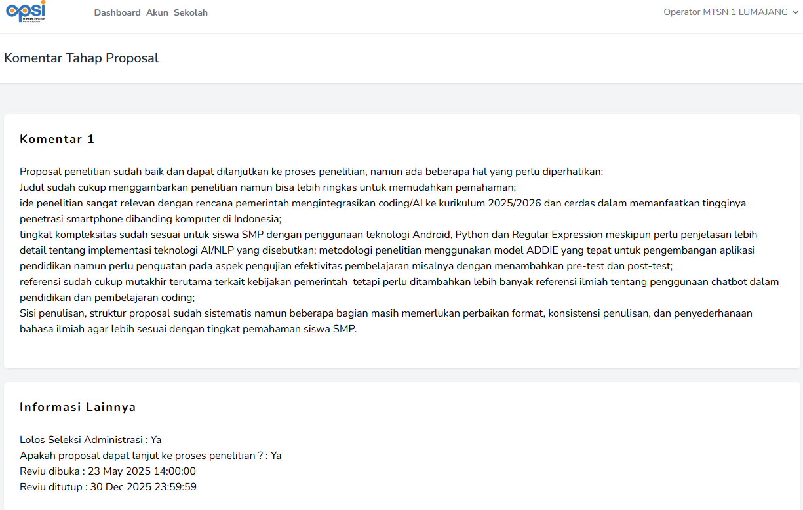

10. **2025 - Finalis Kreasi 2025**  
    _Kompetisi Riset dan Inovasi Siswa Indonesia 2025, Jakarta._

    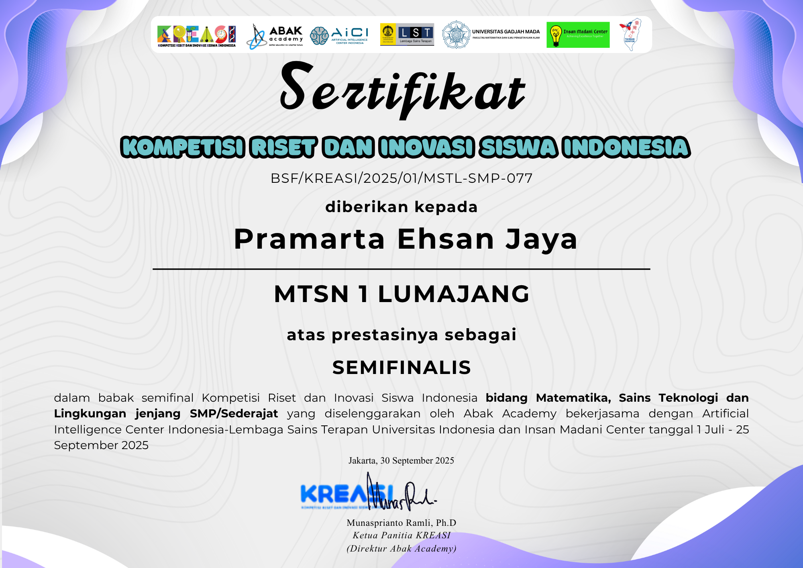

11. **2025 - 1st Place 14th World Robotic For Peace**  
    _Coding game animation by Scratch._

    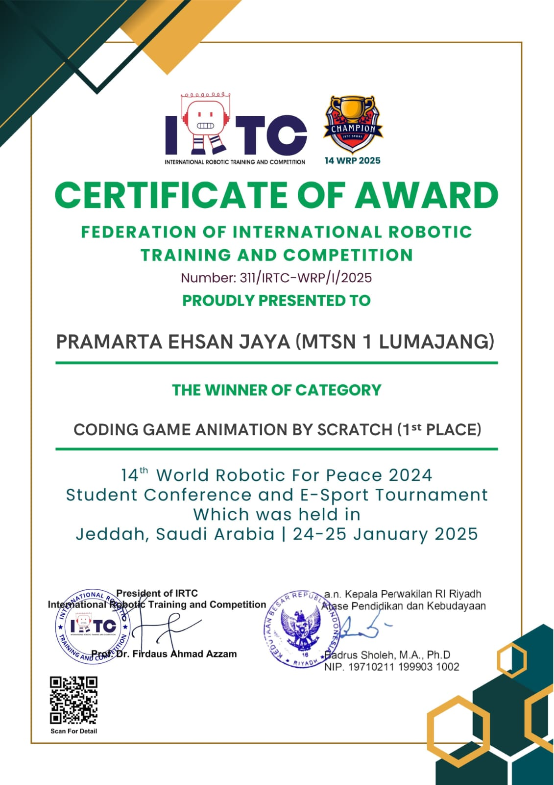  
    Referensi:  
    [Pemenang IRTC 2025](https://rapmafm-ukm.ums.ac.id/2025/01/dua-siswa-man-1-pasuruan-raih-medali.html)

12. **2024 - Gold Indonesian Scratch Competition 2024 (Terkurasi Puspresnas)**  
    _Coding game animation by Scratch STEM-SPARK 2024, Universitas Langlangbuana, Bandung._

    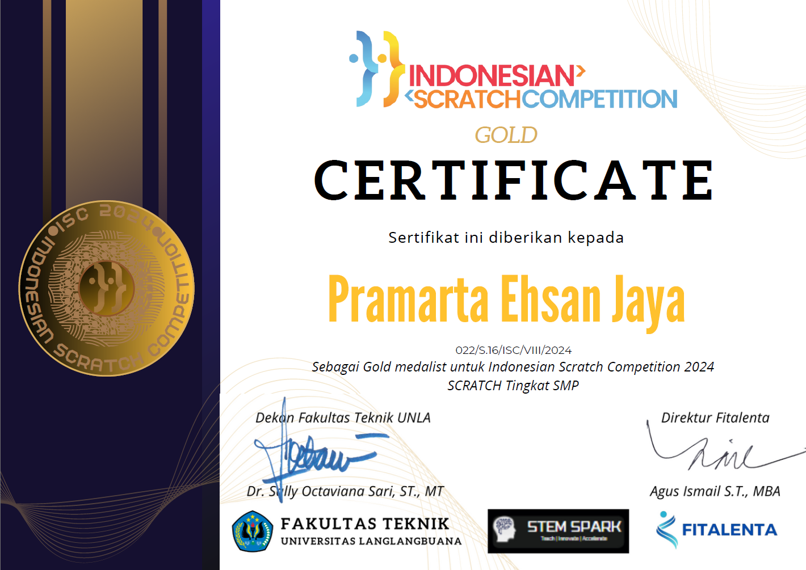  
    Referensi:  
    [Fitalenta](https://isc.fitalenta.co.id/projects)  
    [Pembuatan Project](https://www.youtube.com/watch?v=ezdoBcfuRQU)  
    [Awarding Pemenang](https://www.youtube.com/live/1mCWyoKpBj0?si=AUxDArBQN8U0P0K6&t=4951)  
    [Berita](https://bilikwarta.com/mtsn-1-lumajang-raih-juara-1-di-indonesian-scratch-competition-stem-spark-2024/)

13. **2024 - Perak International Scratch Olympiad 2024**  
    _Coding game animation by Scratch._

    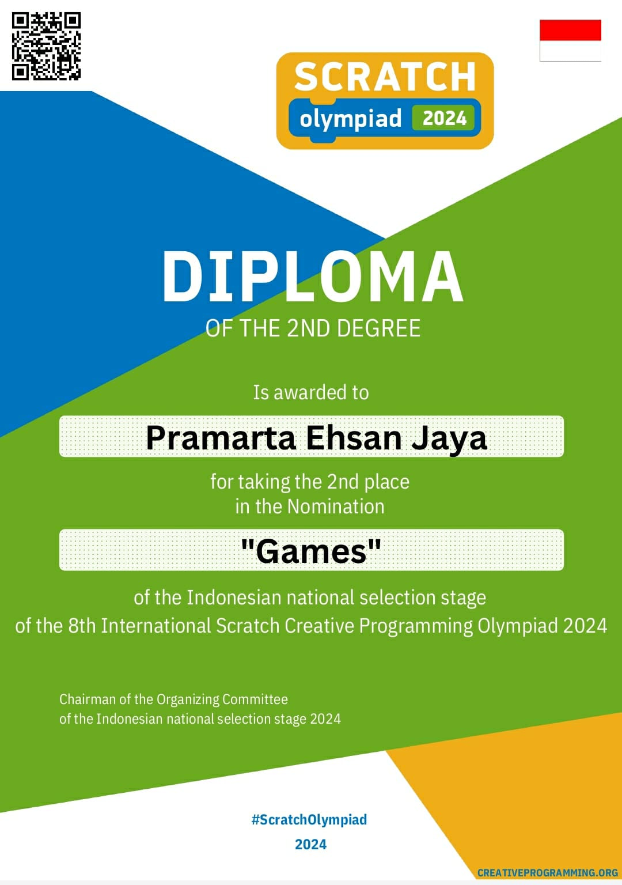  
    Referensi:  
    [Creative Programming](https://creativeprogramming.org/)  
    [Pemenang](https://docs.google.com/spreadsheets/d/e/2PACX-1vQ_LsrbCla-k-n4MCEyAa8WUxYI6xCJMAzdb8F43iRBvfG35iekVD0w-8MkZhKKTQ/pubhtml)

14. **2024 - Juara 3 Kejurnas Robotika Nasional**  
    _Game Animation Scratch, Surabaya._

    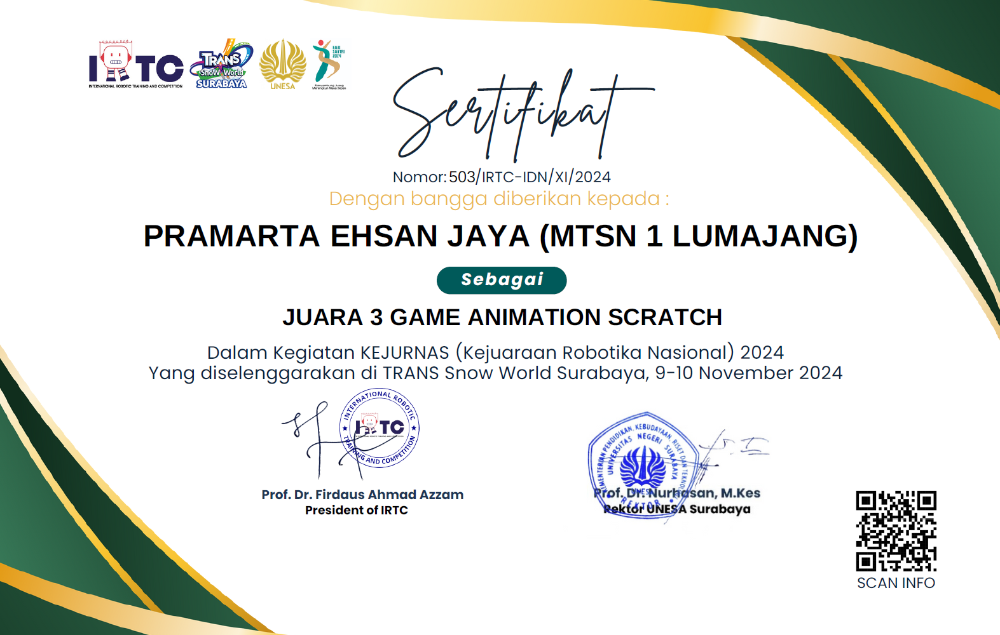

15. **2024 - Best Script Information Technology Creative Competition 2024**  
    _Teknologi Informasi, Fakultas Teknik, Universitas Udayana, Bali._

    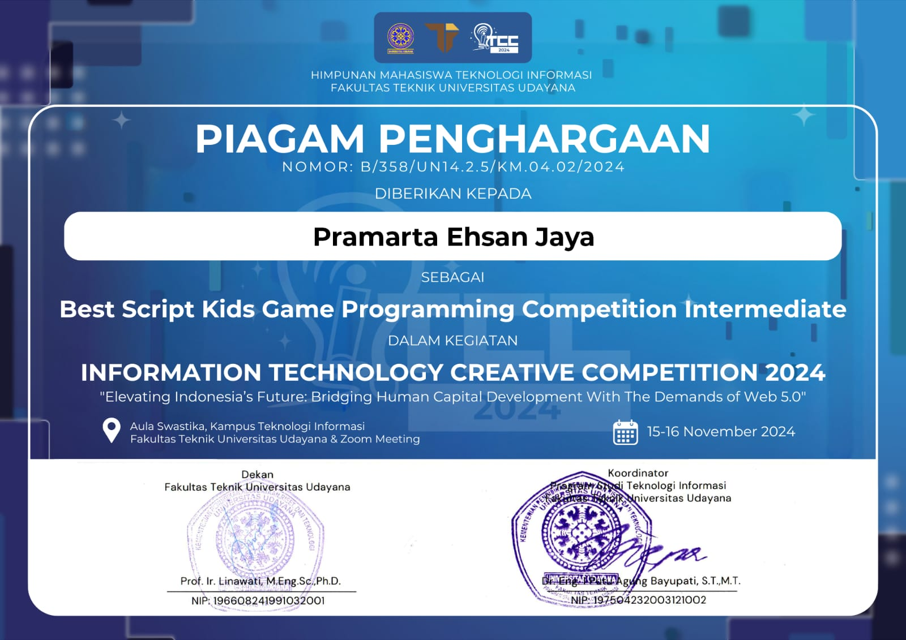  
    Referensi:  
    [ITCC](https://itcc.hmtiudayana.id/)

16. **2023 - Juara 2 Lomba Scratch Coding Elass 2023**

    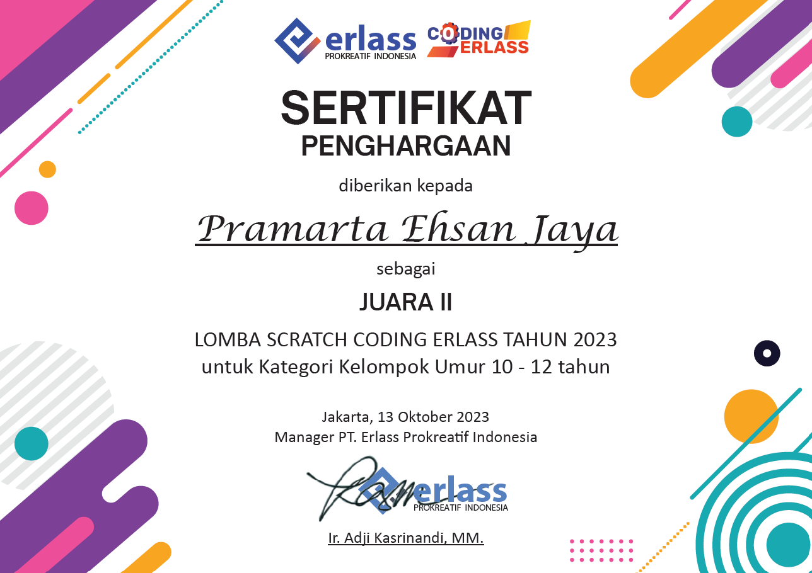  
    Referensi:  
    [Awarding Pemenang](https://m.youtube.com/watch?v=U3F9Dw6B-Jg)

17. **2023 - Juara 1 Kodingbean Kompetisi Coding Nasional 2023**

    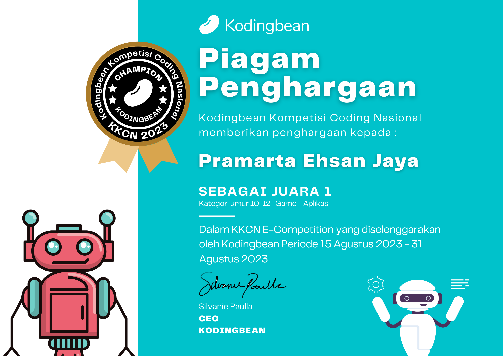

---
